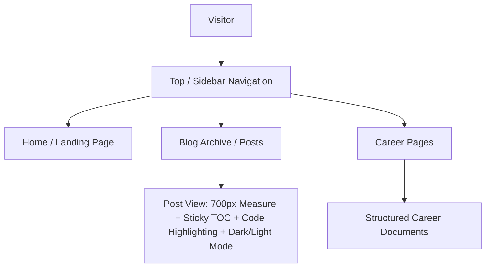

# Requirements

### Overview & Goals
Transition the blog from the legacy single-page *Prologue* portfolio theme to a modern, dedicated technical writing theme (such as *Chirpy* or *Minimal Mistakes* configured for publishing). The primary goal is to maximize legibility, reader utility, and long-term maintainability for technical essays and professional thought leadership.

### Scope
- **In Scope**:
  - Reconfiguring `_config.yml` and `Gemfile` for the chosen writing theme.
  - Standardizing post front matter and layout for optimal reading measure (65–75 chars), font hierarchy, and code syntax highlighting.
  - Converting custom collections (`_sections` and `_career_sections`) and pages (`index.md`, `career.md`, `blog.md`) into clean structured pages compatible with the new theme.
  - Ensuring search, category/tag indexing, dark/light mode, and social/analytics integrations function seamlessly.
  - Removing obsolete legacy SCSS and Skel.js overrides.
- **Out of Scope**:
  - Rewriting existing post content or career copy.
  - Modifying external domain or DNS configurations.

### User Stories
- **As a reader**, I want comfortable typography, high contrast, and a focused reading column so that I can read long technical essays without eye fatigue.
- **As a technical reader**, I want legible code snippets, reading time estimates, and an accessible table of contents so that I can easily parse and navigate technical articles.
- **As the author**, I want an out-of-the-box writing theme with low maintenance overhead so that I can publish new content effortlessly without fighting legacy layout hacks.

### Functional Requirements
- **Reading Typography**: 17–18px body font, optimal line measure (max width ~700–720px), distinct heading scale with bold optical weights.
- **Post Metadata & Navigation**: Unified post headers with publication date, estimated reading time, category/tag chips, and table of contents for long-form essays.
- **Theme Capabilities**: Responsive top navigation / sidebar, dark/light theme support, and code syntax highlighting.
- **Page Preservation**: Home introduction, About info, Career documentation, and standalone documents remain accessible and cleanly formatted.
- **Integrations**: Preserve Google Analytics (`G-GZ2DSHP5CN`), Twitter summary cards, RSS feeds, and URL redirect handling (`jekyll-redirect-from`).

# Technical Design

### Current Implementation
- The site currently uses `chrisbobbe/jekyll-theme-prologue` via `remote-theme` in `_config.yml`.
- Prologue is heavily customized through custom layouts in `_layouts/` (`post.html`, `blog.html`, `career.html`, `career_page.html`, `home.html`, `page.html`), includes in `_includes/`, and SCSS in `_sass/jekyll-theme-prologue.scss` relying on the legacy `skel.js` grid system.
- Content is spread across `_posts/` (55+ posts), `_sections/` (landing sections), and `_career_sections/` (career documents).

### Key Decisions
1. **Target Theme**: Adopt a proven, feature-rich technical writing theme (*Chirpy* or *Minimal Mistakes*) via GitHub Pages compatible remote-theme or Ruby gem.
   - *Rationale*: Delivers immediate utility with built-in dark/light mode, search, TOC, syntax highlighting, and zero maintenance of low-level CSS frameworks.
2. **Prose Geometry**: Standardize article container width to a centered 680–720px max-width container.
   - *Rationale*: Eliminates horizontal eye fatigue caused by full-width or off-center reading columns.
3. **Collection Restructuring**: Simplify `_sections` and `_career_sections` into native Jekyll pages or theme-supported subpages.
   - *Rationale*: Removes reliance on Prologue's section-scrolling architecture while maintaining full access to career and bio content.

### Proposed Architecture & Flow

### Affected Files & Components
- `_config.yml`: Theme configuration, author profile, plugin list, navigation items.
- `Gemfile` & `Gemfile.lock`: Theme gems and dependencies.
- `_layouts/` & `_includes/`: Prune legacy Prologue overrides; retain only theme-specific customizations if needed.
- `_sass/`: Remove obsolete `skel.js` stylesheets; introduce custom styling overrides only where necessary.
- `_posts/`: Front matter audit to ensure seamless metadata rendering.
- `index.md`, `blog.md`, `career.md`: Reconfigured to use standard theme layouts (`home`, `archives` or `page`).

### Risks & Mitigations
- **Broken Front Matter Attributes**: Older posts may use legacy keys (`subtitle`, `beforetoc`, `author.web`).
  - *Mitigation*: Run a front matter audit and provide backwards compatibility in layouts or bulk-normalize keys.
- **Plugin Incompatibility with GitHub Pages**: Certain plugins cannot run in GitHub Pages safe mode.
  - *Mitigation*: Stick to GitHub Pages supported gems and standard `remote-theme` workflows.

# Testing

### Validation Approach
Verify that the migrated blog builds cleanly, renders all post content and assets accurately, and provides a significant improvement in reading ergonomics.

### Key Scenarios
1. **Site Build & Asset Pipeline**:
   - `bundle exec jekyll build` completes with 0 errors and no missing layout warnings.
2. **Post Rendering & Legibility**:
   - Verify post pages display clean typography (17–18px, 680–720px measure, bold headers).
   - Verify syntax-highlighted code blocks, blockquotes, images, and tables render properly.
   - Verify reading time and table of contents generate correctly.
3. **Landing & Career Pages**:
   - Verify the homepage provides clear biographical context and links to recent articles.
   - Verify career documents (`/career`) render without missing content.
4. **Theme Features**:
   - Verify dark and light mode toggle functions smoothly without contrast regressions.
   - Verify responsive navigation on mobile (<768px) and desktop (>1024px) viewports.
5. **SEO & Analytics**:
   - Inspect output HTML to verify Google Analytics tag (`G-GZ2DSHP5CN`) and SEO metadata are present.
   - Verify existing post URLs and redirects remain intact.

# Delivery Steps

### ✓ Step 1: Configure theme dependencies and site settings
The site build is configured with the new dedicated technical blogging theme and required dependencies.

- Update `_config.yml` with the new theme specification (`remote-theme` or `theme`), navigation hierarchy, author profile, and feature toggles (dark/light mode, reading time, syntax highlighter).
- Update `Gemfile` to include necessary gems and remove legacy Prologue gemspec references.
- Verify basic Jekyll build passes without gem resolution or syntax conflicts.

### ✓ Step 2: Adapt post metadata and typography rendering
All 55+ blog posts render cleanly with standardized front matter, reading metrics, and modern typography.

- Standardize post front matter across `_posts/` (e.g. mapping `subtitle`, `image`, `author` fields to the target theme's schema).
- Configure prose styling parameters: optimal line measure (65–75 characters / ~700px max width), font scale (17–18px body, 1.65 line height), and heading hierarchy.
- Configure code block syntax highlighting and inline code styling for technical readability.

### ✓ Step 3: Migrate landing page and career collections
Portfolio, About, and Career materials are converted into clean standalone pages integrated with site navigation.

- Migrate homepage content from `_sections/` into a streamlined modern landing page (`index.md`) with author bio and recent writing.
- Migrate `_career_sections/` and `career.md` into dedicated, clean career pages or structured subpages.
- Update global navigation links to provide clear routing between Home, Blog archive, Career, and external profiles.

### ✓ Step 4: Clean up legacy templates and validate site build
Legacy theme overrides are removed and remaining UI elements (dark mode toggle, search, analytics, redirects) are verified.

- Deprecate obsolete Prologue layout files (`_layouts/`, `_includes/`, and legacy `_sass/libs/skel` assets).
- Validate Google Analytics (`G-GZ2DSHP5CN`), `jekyll-redirect-from` routing, and SEO tags.
- Verify responsive layout across mobile and desktop viewports, dark/light theme switching, and local link integrity.